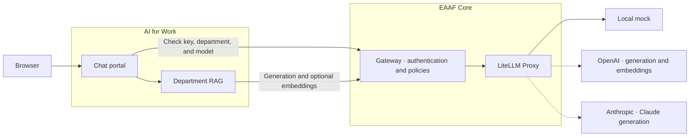

# EAAF Work

EAAF Work is the chat and document-search application for EAAF. It serves the Global, HR, IT, and Marketing spaces and connects to the [EAAF Core Gateway](https://github.com/tandrian06/eaaf) over HTTP.

## Run locally

Start EAAF Core with the scoped authorization and embeddings endpoints using its Docker Compose instructions. From this repository in PowerShell with Python 3.14:

```powershell
python -m venv .venv
.\.venv\Scripts\python.exe -m pip install -r requirements.txt
.\.venv\Scripts\python.exe -m uvicorn eaaf_work.app:app --host 127.0.0.1 --port 8001
```

Open [EAAF Work](http://127.0.0.1:8001/) and enter the application key for the selected space from Core's local `.env`. Work uses `http://127.0.0.1:8000` by default. Set `EAAF_GATEWAY_URL` before starting Work to use another Gateway.

## Department search

Choose HR, enter the HR application key, enable **Use department knowledge**, and ask **Comment poser des congés ?**. The answer includes the source `hr-leave`. IT and Marketing have their own fictional corpora. Global offers chat.

Work loads the Markdown files listed in `config/knowledge.yaml`. To add a source, place a short UTF-8 Markdown file in the matching `knowledge/` directory, register a title and keywords in the manifest, and restart Work.

Keyword search runs locally. Semantic search is available when Core enables the OpenAI overlay and permits the embedding alias for the department. Work holds the document vectors in memory and sends embedding batches through Core. Each batch and each generation counts as its own governed request. Use synthetic inputs with external providers.

## Try Claude in HR

Enable Anthropic in [EAAF Core](https://github.com/tandrian06/eaaf#optional-anthropic-mode). In the HR space, enter the HR application key and select `eaaf-claude-haiku`. Enable **Use department knowledge**, choose keyword search, and ask **Comment poser des congés ?**. Work retrieves the `hr-leave` source locally and sends the selected excerpt through Core and LiteLLM to Anthropic. Work asks Claude to reply in French. The Sources panel shows the original English excerpt.

With both providers enabled in Core, select `eaaf-openai-mini` to compare generation using the same documents. Semantic retrieval continues to use OpenAI embeddings.

## Architecture



Work asks Core to authorize the application key, department, and selected model before searching a corpus. Work forwards the same credential for generation and optional embeddings. Core applies usage limits and audit to those model calls. The browser holds the key in page memory.

## Tests

```powershell
.\.venv\Scripts\python.exe -m pip install -r requirements-dev.txt
.\.venv\Scripts\python.exe -m pytest -q
```

## Standalone container

Build and start Work with the Core URL reachable from the Work container.

~~~powershell
$env:EAAF_GATEWAY_URL = 'https://YOUR_CORE_ENDPOINT'
docker compose up --build --wait
~~~

Open http://127.0.0.1:8001/chat/hr. Enter the HR application key issued by
the selected Core deployment. Work forwards that credential for the scoped
authorization and completion calls. Keep provider credentials and the
LiteLLM master key on Core.

Work's Compose project has its own lifecycle and contains only Work.
It packages the department corpus and exposes the frontend on host loopback.
The process health endpoint is /healthz. It reports Work availability.
Verify /chat/hr/options and an authenticated completion to check the Core
connection. Core connection failures are reported as 502 and timeouts as 504.

For local Docker Desktop testing, a host API may be reachable through
http://host.docker.internal:8000. Verify connectivity with the host API's
actual binding. An address using 127.0.0.1 from inside Work refers to the
Work container. In AWS, configure Core's private service endpoint.

Changing EAAF_GATEWAY_URL requires recreating Work. Changes to the packaged
corpus require rebuilding the Work image. The browser holds the application
key in memory. The remote Core determines available models and enforces its
own policies, quotas and audit.

For a private Core certificate, mount its public PEM certificate into Work
and set EAAF_GATEWAY_CA_FILE to that path inside the container. Work checks
the certificate chain and the hostname or IP in EAAF_GATEWAY_URL.
The certificate's private key stays on Core. A missing or invalid CA file
fails Work startup. Certificate replacement requires redistributing the
public certificate and recreating Work.
