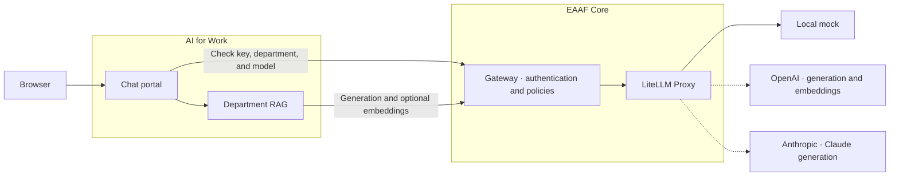

# EAAF Work

EAAF Work is the chat and document-search application for EAAF. It serves the Global, HR, IT, and Marketing spaces and connects to the [EAAF Core Gateway](https://github.com/tandrian06/eaaf) over HTTP.

## Run locally

Start EAAF Core with the scoped authorization and embeddings endpoints using its Docker Compose instructions. From this repository in PowerShell with Python 3.14:

```powershell
python -m venv .venv
.\.venv\Scripts\python.exe -m pip install -r requirements.txt
.\.venv\Scripts\python.exe -m uvicorn eaaf_work.app:app --host 127.0.0.1 --port 8001
```

Open [EAAF Work](http://127.0.0.1:8001/) and enter the application key for the selected space from Core's local `.env`. Work uses `http://127.0.0.1:8000` by default. Set `EAAF_GATEWAY_URL` before starting Work to use another Gateway.

## Department search

Choose HR, enter the HR application key, enable **Use department knowledge**, and ask **Comment poser des congés ?**. The answer includes the source `hr-leave`. IT and Marketing have their own fictional corpora. Global offers chat.

Work loads the Markdown files listed in `config/knowledge.yaml`. To add a source, place a short UTF-8 Markdown file in the matching `knowledge/` directory, register a title and keywords in the manifest, and restart Work.

Keyword search runs locally. Semantic search is available when Core enables the OpenAI overlay and permits the embedding alias for the department. Work holds the document vectors in memory and sends embedding batches through Core. Each batch and each generation counts as its own governed request. Use synthetic inputs with external providers.

## Try Claude in HR

Enable Anthropic in [EAAF Core](https://github.com/tandrian06/eaaf#optional-anthropic-mode). In the HR space, enter the HR application key and select `eaaf-claude-haiku`. Enable **Use department knowledge**, choose keyword search, and ask **Comment poser des congés ?**. Work retrieves the `hr-leave` source locally and sends the selected excerpt through Core and LiteLLM to Anthropic. Work asks Claude to reply in French. The Sources panel shows the original English excerpt.

With both providers enabled in Core, select `eaaf-openai-mini` to compare generation using the same documents. Semantic retrieval continues to use OpenAI embeddings.

## Architecture



Work asks Core to authorize the application key, department, and selected model before searching a corpus. Work forwards the same credential for generation and optional embeddings. Core applies usage limits and audit to those model calls. The browser holds the key in page memory.

## Tests

```powershell
.\.venv\Scripts\python.exe -m pip install -r requirements-dev.txt
.\.venv\Scripts\python.exe -m pytest -q
```
